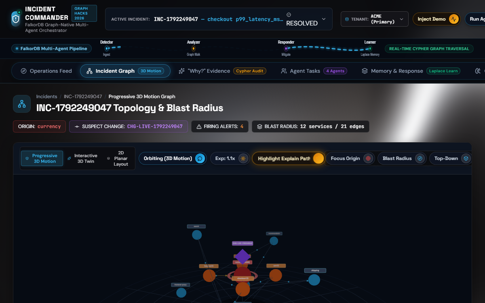
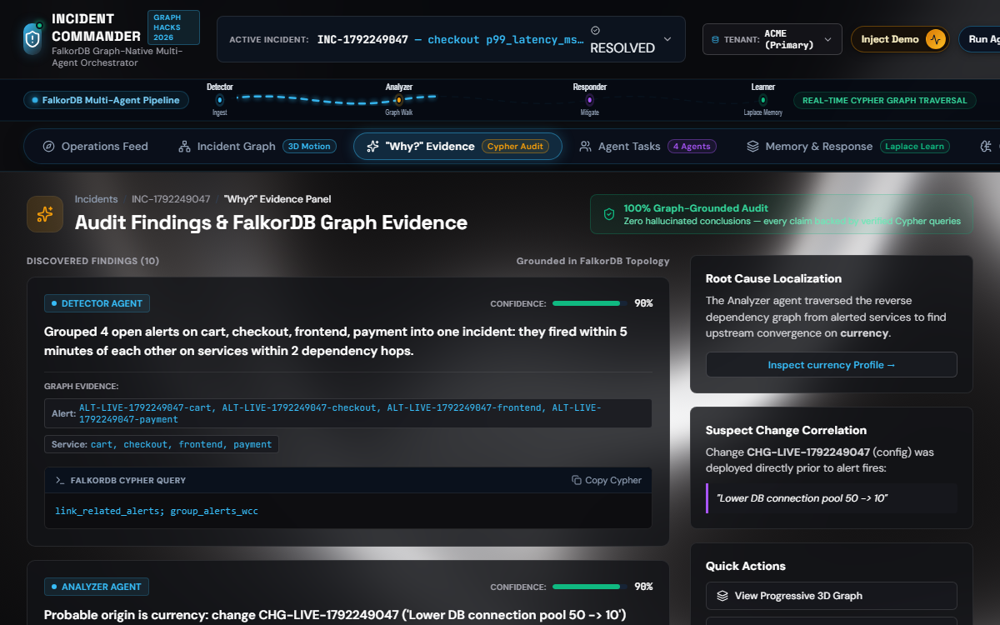
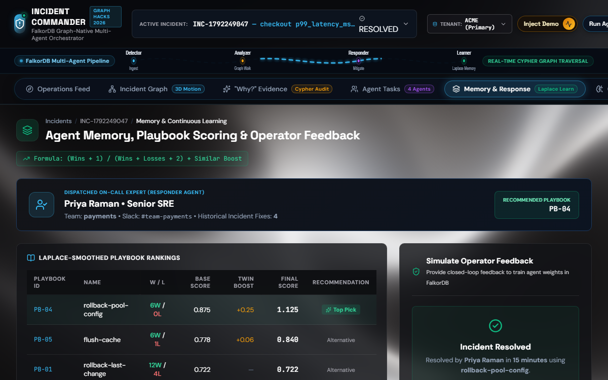
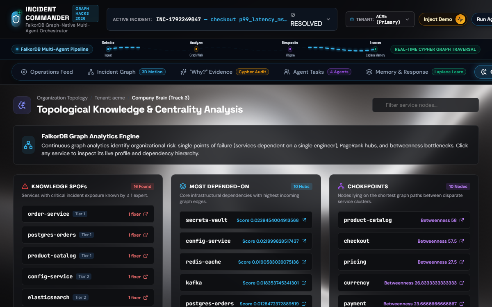
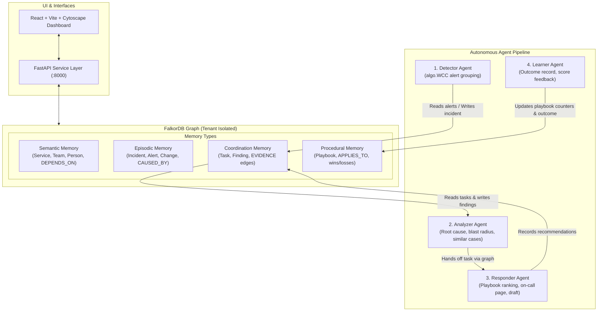
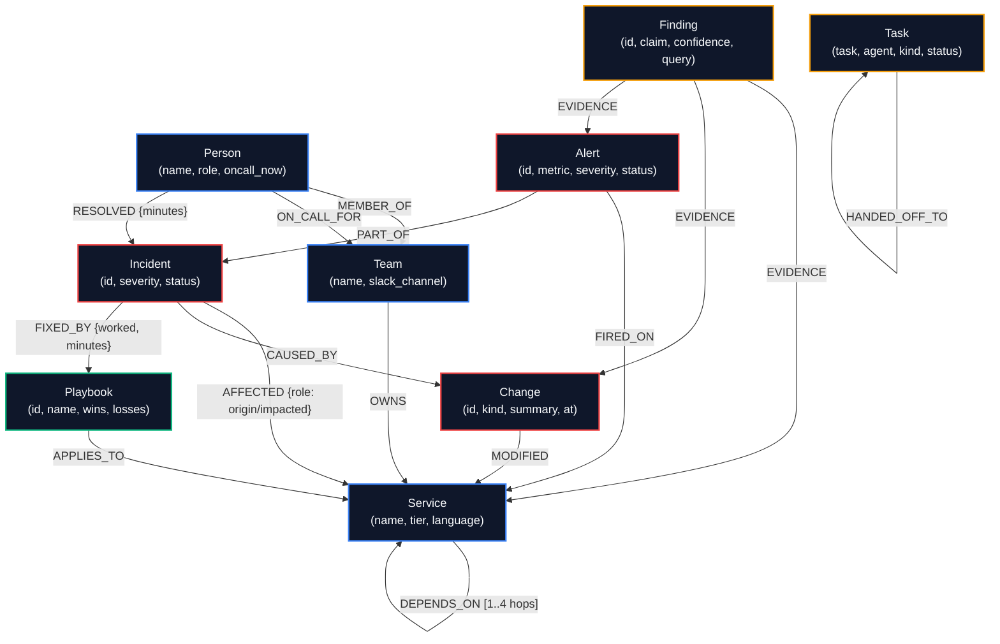

# Incident Commander: Graph-Powered AI Incident Response Team

[](https://github.com/Thirumughil/Incident-Commander/actions/workflows/tests.yml)
[](LICENSE)
[](https://falkordb.com/)
[](src/ic/api.py)
[](frontend/)

Incident Commander is an autonomous incident response agent team whose shared brain is a FalkorDB knowledge graph. When cascading alerts fire, a multi-agent pipeline (Detector, Analyzer, Responder, Learner) traverses the service dependency topology to identify root causes, calculate blast radius, recall similar past incidents, rank proven playbooks, and page the most experienced on-call engineer—grounding every decision with verifiable graph evidence links rather than prompt hallucination, and closing the feedback loop by recording operator outcomes directly into procedural graph memory.

<p align="center">
  
  
</p>
<p align="center">
  
  
</p>

---

## Tracks Entered & How Each Is Satisfied

Built for **Graph Hacks: Context for AI Agents** (WeMakeDevs x FalkorDB). Entered in all three hackathon tracks:

| Track | Hackathon Track Focus | How Incident Commander Satisfies It |
| :--- | :--- | :--- |
| **Track 1** | **Agents That Act on Connected Data** | Agents execute Cypher queries on FalkorDB at every step: Detector groups open alerts using Weakly Connected Components (`algo.WCC`); Analyzer traverses `DEPENDS_ON` edges for blast radius and correlates recent `Change` events deployed upstream; Responder navigates `OWNS` and `ON_CALL_FOR` relationships to page the right human on-call engineer. |
| **Track 2** | **Agent Memory and Coordination** | Implements four distinct graph memory tiers in FalkorDB: Semantic (topology, teams), Episodic (past incidents and alert cascades), Procedural (learned playbook win/loss counters scored via $(s+1)/(s+f+2)$), and Coordination (immutable `Task` and `Finding` nodes with `EVIDENCE` edges). Agents never call each other via direct APIs; they coordinate strictly by reading and writing graph memory tasks with tenant-level run locks. |
| **Track 3** | **Company Brain** | Turns operational history into an institutional intelligence asset: identifies Knowledge Single Points of Failure (services where only one person has ever fixed an outage), highlights critical architectural bottlenecks using PageRank (`algo.pageRank`) and Betweenness Centrality (`algo.betweenness`), and maintains full service profiles with historical incident causes and expert rosters. |

---

## Architecture Diagram



---

## Data Model & Graph Memory

Each tenant runs in an isolated FalkorDB graph (`tenant_<id>`). The graph models four primary memory tiers:

### 1. Node Labels & Core Properties
- `Service`: `name` (id), `tier` (1, 2, 3), `language`, `slo_ms`.
- `Team`: `name` (id), `slack_channel`.
- `Person`: `name` (id), `role`, `oncall_now` (boolean).
- `Change`: `id`, `kind` (`config`, `deploy`, `infra`), `summary`, `at` (epoch timestamp).
- `Alert`: `id`, `metric`, `severity` (`critical`, `warning`), `fired_at`, `status` (`open`, `grouped`, `cleared`).
- `Incident`: `id`, `title`, `severity`, `status` (`open`, `resolved`), `started_at`, `resolved_at`, `recommended_playbook`.
- `Playbook`: `id`, `name`, `successes` (wins), `failures` (losses).
- `Task`: `task` (id), `agent`, `kind` (`detect`, `analyze`, `respond`, `learn`), `status` (`open`, `done`, `handed_off`, `failed`), `created_at`, `finished_at`.
- `Finding`: `id`, `agent`, `claim`, `confidence`, `query`, `created_at`.

### 2. Relationships (Edges)
- `(:Service)-[:DEPENDS_ON {kind, criticality}]->(:Service)`
- `(:Team)-[:OWNS]->(:Service)`
- `(:Person)-[:MEMBER_OF]->(:Team)`
- `(:Person)-[:ON_CALL_FOR]->(:Team)`
- `(:Person)-[:RESOLVED {minutes}]->(:Incident)`
- `(:Change)-[:MODIFIED]->(:Service)`
- `(:Alert)-[:FIRED_ON]->(:Service)`
- `(:Alert)-[:PART_OF]->(:Incident)`
- `(:Incident)-[:AFFECTED {role}]->(:Service)` (role: `'origin'` or `'impacted'`)
- `(:Incident)-[:CAUSED_BY]->(:Change)`
- `(:Incident)-[:FIXED_BY {worked, minutes}]->(:Playbook)`
- `(:Playbook)-[:APPLIES_TO]->(:Service)`
- `(:Finding)-[:EVIDENCE]->(:Node)` (links to concrete `Service`, `Change`, `Alert`, `Incident`, `Playbook`, or `Person` nodes)
- `(:Task)-[:HANDED_OFF_TO {reason, at}]->(:Agent)`

### 3. Graph Schema & Agent Traversal Map

The diagram below maps all knowledge graph nodes, relationships, and the four multi-agent query traversal paths:



#### How Agents Query the Graph

| Agent | Memory Tier Queried | Relationships Traversed | Key Cypher Operations | Decision Driven by Graph |
| :--- | :--- | :--- | :--- | :--- |
| **Detector** | Episodic + Coordination | `Alert-[:FIRED_ON]->Service`<br/>`Alert-[:RELATED_TO]->Alert` | `algo.WCC` clustering on temporal/topological proximity | Groups related cascading alerts into unified `Incident` node; writes initial `analyze` `Task`. |
| **Analyzer** | Semantic + Episodic + Coordination | `Service-[:DEPENDS_ON*0..3]->Service`<br/>`Change-[:MODIFIED]->Service`<br/>`Service-[:DEPENDS_ON*1..4]->Service` | Multi-hop upstream correlation (`suspect_changes.cypher`) and downstream blast radius (`blast_radius.cypher`) | Determines true root-cause service (not symptom services), calculates exact impact radius, writes `Finding` with `EVIDENCE` edges. |
| **Responder** | Episodic + Procedural + Semantic | `Incident-[:AFFECTED]->Service`<br/>`Playbook-[:APPLIES_TO]->Service`<br/>`Team-[:OWNS]->Service`<br/>`Person-[:ON_CALL_FOR]->Team` | `similar_incidents.cypher`<br/>`best_playbook.cypher`<br/>`who_to_page.cypher` | Ranks historical playbooks via Laplace score $(s+1)/(s+f+2)$; filters out decoy incidents; pages proven on-call engineer based on prior `[:RESOLVED]` count. |
| **Learner** | Procedural + Episodic + Coordination | `Incident-[:FIXED_BY]->Playbook`<br/>`Person-[:RESOLVED]->Incident`<br/>`Finding-[:EVIDENCE]->Playbook` | Atomic counter increments (`SET pb.successes += 1`) and edge creation | Closes feedback loop by updating playbook win/loss counters directly in graph memory upon human operator resolution confirmation. |

---

## Key Cypher Queries

All agent reasoning executes directly against FalkorDB via parameterised Cypher queries in `queries/`:

### 1. Blast Radius (`queries/blast_radius.cypher`)
*Finds all downstream services that depend on the failing service up to 4 hops away, nearest first.*
```cypher
MATCH p = (impacted:Service)-[:DEPENDS_ON*1..4]->(origin:Service {name: $service})
RETURN impacted.name AS service, impacted.tier AS tier, min(length(p)) AS hops
ORDER BY hops, tier, service
```

### 2. Suspect Changes (`queries/suspect_changes.cypher`)
*Identifies recent deployments or configuration changes deployed to the alerting service or its upstream dependencies within the 2 hours prior.*
```cypher
MATCH (c:Change)-[:MODIFIED]->(s:Service)
WHERE c.at >= $incident_start - 7200
MATCH p = (affected:Service {name: $service})-[:DEPENDS_ON*0..3]->(s)
RETURN c.id AS change, c.kind AS kind, c.summary AS summary, c.at AS at,
       s.name AS changed_service, min(length(p)) AS distance
ORDER BY distance, at DESC
LIMIT 5
```

### 3. Similar Incidents (`queries/similar_incidents.cypher`)
*Retrieves past resolved incidents sharing the same suspected origin, scoring them by alerting service overlap and change causality.*
```cypher
MATCH (i:Incident {status: 'resolved'})-[:AFFECTED {role: 'origin'}]->(:Service {name: $suspect})
OPTIONAL MATCH (i)-[:AFFECTED]->(s:Service) WHERE s.name IN $alerting
WITH i, count(DISTINCT s) AS overlap
OPTIONAL MATCH (i)-[:CAUSED_BY]->(c:Change)
WITH i, overlap, count(c) AS change_caused
OPTIONAL MATCH (i)-[f:FIXED_BY]->(pb:Playbook) WHERE f.worked = true
RETURN i.id AS incident, i.title AS title, i.started_at AS started_at, overlap, change_caused,
       overlap + 2 * change_caused AS score, pb.id AS playbook_id, pb.name AS playbook, f.minutes AS minutes
ORDER BY score DESC, started_at DESC
LIMIT 5
```

### 4. Playbook Ranking (`queries/best_playbook.cypher`)
*Ranks playbooks applicable to the origin service using Laplace-smoothed historical success rates so 1-for-1 does not beat 9-for-10.*
```cypher
MATCH (pb:Playbook)-[:APPLIES_TO]->(:Service {name: $service})
RETURN pb.id AS playbook_id, pb.name AS name, pb.successes AS wins, pb.failures AS losses,
       toFloat(pb.successes + 1) / (pb.successes + pb.failures + 2) AS score
ORDER BY score DESC, name
```

### 5. Weakly Connected Components Alert Grouping (`queries/group_alerts_wcc.cypher`)
*Clusters open alerts that fired within 5 minutes of each other on services within 2 dependency hops into a unified incident.*
```cypher
CALL algo.WCC({nodeLabels: ['Alert'], relationshipTypes: ['RELATED_TO']}) YIELD node, componentId
WHERE node.status = 'open'
RETURN componentId, collect(node.id) AS alerts
ORDER BY size(alerts) DESC
```

### 6. Dependency Importance / PageRank (`queries/pagerank.cypher`)
*Computes topological centrality over service dependencies to establish blast radius priority.*
```cypher
CALL algo.pageRank('Service', 'DEPENDS_ON') YIELD node, score
RETURN node.name AS service, score
ORDER BY score DESC
LIMIT 10
```

### 7. Topological Chokepoints / Betweenness (`queries/betweenness.cypher`)
*Identifies critical architectural bridges sitting on high volumes of shortest dependency paths.*
```cypher
CALL algo.betweenness({nodeLabels: ['Service'], relationshipTypes: ['DEPENDS_ON']}) YIELD node, score
RETURN node.name AS service, score
ORDER BY score DESC
LIMIT 10
```

### 8. Who to Page (`queries/who_to_page.cypher`)
*Finds currently on-call engineers for the team owning the origin service, ranked by prior successful incident resolutions.*
```cypher
MATCH (s:Service {name: $service})<-[:OWNS]-(t:Team)<-[:ON_CALL_FOR]-(p:Person)
WHERE p.oncall_now = true
OPTIONAL MATCH (p)-[r:RESOLVED]->(:Incident)-[:AFFECTED]->(s)
RETURN p.name AS person, p.role AS role, t.name AS team, t.slack_channel AS channel, count(r) AS prior_fixes
ORDER BY prior_fixes DESC
```

### 9. Knowledge Single Point of Failure (`queries/knowledge_spof.cypher`)
*Surfaces services where exactly one engineer has ever resolved an outage, flagging critical organizational knowledge silos.*
```cypher
MATCH (s:Service)
OPTIONAL MATCH (p:Person)-[:RESOLVED]->(:Incident)-[:AFFECTED]->(s)
WITH s, count(DISTINCT p) AS people_who_fixed_it
WHERE people_who_fixed_it = 1
RETURN s.name AS service, s.tier AS tier, people_who_fixed_it
ORDER BY tier, service
```

---

## Questions an Agent Must Answer

Autonomous incident response requires reasoning over interconnected topology rather than isolated logs or vector similarity. The table below details why each operational question requires multi-hop graph traversal in FalkorDB:

| Question | Why It Needs Multi-Hop Traversal | Cypher Query File | What the Query Returns |
| :--- | :--- | :--- | :--- |
| **What is the blast radius?** | Transitive downstream dependency traversal (`[:DEPENDS_ON*1..4]`) to map failing service impact. | `queries/blast_radius.cypher` | Impacted downstream service names, architectural tier, and hop distance. |
| **What recent deployment triggered this?** | Correlates changes on origin or upstream dependencies (`[:DEPENDS_ON*0..3]`) deployed within 2 hours. | `queries/suspect_changes.cypher` | Top suspect change IDs, kind (`config`/`deploy`), summary, timestamp, and hop distance. |
| **Which historical incidents match this failure?** | Joins past resolved incidents by origin, calculating alerting service overlap and change causality. | `queries/similar_incidents.cypher` | Top 5 similar resolved incidents, overlap count, change causality, and working playbook. |
| **Which playbook has the highest proven win rate?** | Aggregates historical resolution edges (`APPLIES_TO`, `FIXED_BY`) and calculates Laplace score $(s+1)/(s+f+2)$. | `queries/best_playbook.cypher` | Ranked playbooks with historical wins, losses, and smoothed win probability. |
| **Who is on-call with proven expertise?** | Navigates `(:Service)<-[:OWNS]-(:Team)<-[:ON_CALL_FOR]-(:Person)` and counts past `[:RESOLVED]` edges. | `queries/who_to_page.cypher` | Active on-call engineer name, role, team Slack channel, and prior fix count. |
| **Which services are knowledge silos (SPOF)?** | Aggregates unique engineers who have ever resolved an outage for each service; flags count = 1. | `queries/knowledge_spof.cypher` | Critical services where exactly one person has ever fixed an outage. |
| **Which architectural bottlenecks have highest centrality?** | Algorithmic graph centrality (PageRank and Betweenness) over service dependency topology. | `queries/pagerank.cypher` / `queries/betweenness.cypher` | Top 10 architectural chokepoints and dependency centrality rankings. |
| **How should cascading alerts be clustered?** | Weakly Connected Components (`algo.WCC`) over temporal-topological alert relationships. | `queries/group_alerts_wcc.cypher` | Component IDs and grouped alert IDs clustered into single incidents. |

> [!NOTE]
> *Environment Note:* Evaluated on a deterministic synthetic knowledge graph of 40 services, 8 teams, 22 engineers, and 30 incidents; not production scale.

---

## Why the Decoys Lose

In incident response, naive symptom matching or vector similarity based solely on superficial text alerts (`"checkout slow"`, `"frontend errors"`) frequently misleads agents into choosing the wrong playbooks. In our synthetic dataset, two planted decoys test the pipeline:
- **`INC-021` (Decoy on different service):** Superficial symptom overlap on `checkout` and `frontend`, but its true root cause was `payment`.
- **`INC-007` (Decoy on same service):** Also caused by `currency`, but had lower overlap, was NOT caused by a configuration change, and was resolved by `PB-05` (`flush-cache`).

### Real Graph Ranking (from Live Incident Query)
As verified in `docs/VERIFICATION.md` (Section 5) via `queries/similar_incidents.cypher`:

| Rank | Incident ID | Suspected Origin | Alerting Overlap | Caused by Change? | Composite Score | Working Playbook | Outcome |
| :---: | :--- | :--- | :---: | :---: | :---: | :--- | :--- |
| **#1** | **`INC-014` (True Match)** | `currency` | 1 | Yes (+2) | **3** (or 4) | `PB-04` (`rollback-pool-config`) | **Ranked #1 (Recommended)** |
| **#2** | **`INC-007` (Decoy)** | `currency` | 1 | No (+0) | **1** | `PB-05` (`flush-cache`) | Sub-optimal |
| **—** | **`INC-021` (Decoy)** | `payment` | — | — | **0 (Filtered Out)** | `PB-03` (`scale-out`) | **Excluded by Graph** |

**Why the Graph Wins:**
1. **`INC-021` is eliminated at query time:** Cypher matches `(i:Incident)-[:AFFECTED {role: 'origin'}]->(:Service {name: $suspect})`. Because the suspected origin for our incident is `currency`, `INC-021` is structurally filtered out without hallucinating irrelevant payment fixes.
2. **`INC-014` beats `INC-007` via causal weighting:** The scoring formula `overlap + 2 * change_caused` prioritizes incidents caused by similar configuration changes, boosting `INC-014` over cache flushes.

---

## The Agent Learns from Outcomes

Incident Commander implements a closed-loop learning feedback mechanism directly in FalkorDB procedural memory (`Playbook.successes`, `Playbook.failures`):

### Laplace-Smoothed Playbook Ranking
Success rate is calculated via Laplace smoothing so that $1/1$ ($0.667$) does not outrank $9/10$ ($0.833$):
$$\text{Score} = \frac{\text{successes} + 1}{\text{successes} + \text{failures} + 2}$$

### Measured Live Learning Shift (from `docs/VERIFICATION.md` Section 5)
When the operator confirms `PB-04` (`rollback-pool-config`) successfully mitigated incident `INC-1792243382`:
- **Before Resolve (`PB-04` on `currency`):** Wins: 3, Losses: 0 $\to \text{Score} = \frac{3+1}{3+0+2} = \mathbf{0.800}$ (Composite: 1.050 with $+0.25$ similarity boost from `INC-014`).
- **After Resolve (`PB-04` on `currency`):** Wins: 4, Losses: 0 $\to \text{Score} = \frac{4+1}{4+0+2} = \mathbf{0.833}$ (Composite: 1.083).
- **Episodic Recall Shift:**
  - Before resolve: closest match was `INC-014` (Score: 3, Overlap: 1).
  - After resolve: top closest match dynamically became the freshly resolved live incident `INC-1792243382` (Score: 6, Overlap: 4).

> [!NOTE]
> Failure-outcome handling (`worked=false`) is implemented in `Learner.resolve` (which penalizes the playbook score by incrementing failure counters in graph memory) and is verified by the offline unit test `test_learner_failure_lowers_score` in `tests/test_agents.py`.

---

## How Agents Coordinate

In Incident Commander, **agents never call each other via direct APIs, RPCs, or in-memory message queues**. Instead, coordination is entirely decoupled through FalkorDB:
1. **Detector** groups alerts via Cypher WCC, creates the `Incident` node, and creates an `analyze` `Task` node assigned to `Analyzer`.
2. **Analyzer** queries pending `Task` nodes, investigates upstream changes and blast radius, records `Finding` nodes with `EVIDENCE` edges to concrete graph entities, and updates the task status to `handed_off` targeting `Responder` with reason: `"origin identified: currency"`.
3. **Responder** queries its assigned tasks, executes `similar_incidents` and `best_playbook`, calculates the composite score, records a recommendation `Finding`, drafts a status report, and marks its task `done`.
4. **Learner** executes on human feedback (`POST /incidents/{id}/resolve`): runs an atomic Cypher query updating the incident status and playbook win/loss counters, and writes a `learn` `Task` and `Finding` with evidence links.

Every step leaves an immutable audit trail in FalkorDB.

---

## Local Setup (Tested PowerShell Commands)

Follow these exact steps in Windows PowerShell from the project root:

```powershell
# 1. Start FalkorDB container with append-only persistence
docker compose up -d

# 2. Activate Python virtual environment and install dependencies
# (Assumes venv at python-envs\incident-commander or create a new .venv)
python -m venv .venv
.\.venv\Scripts\Activate.ps1
pip install -r requirements.txt

# 3. Create .env configuration
Copy-Item .env.example .env

# 4. Seed isolated tenant graphs (synthetic deterministic datasets)
python scripts\seed.py --tenant acme --reset
python scripts\seed.py --tenant globex --seed 2 --no-plant --reset

# 5. Verify all Cypher queries against live FalkorDB
python scripts\check_queries.py --tenant acme

# 6. Run offline test suite (55 tests)
python -m unittest discover -s tests -v

# 7. Start FastAPI Backend Server (Port 8000)
python -m uvicorn src.ic.api:app --host 127.0.0.1 --port 8000

# 8. Start Frontend React Dashboard (Port 5173 in a new terminal)
cd frontend
npm install
npm run dev -- --host 127.0.0.1 --port 5173
```

- **Dashboard:** http://localhost:5173
- **FastAPI Swagger Docs:** http://localhost:8000/docs
- **FalkorDB Browser:** http://localhost:3001

---

## Demo Walkthrough

1. **Open Dashboard:** Navigate to `http://localhost:5173`. Notice tenant switch (`tenant_acme`), API health badge, and synthetic data banner.
2. **Inject Scenario:** Click **"Inject Demo Incident"** to simulate a faulty configuration change on `currency` and four cascading alerts on `checkout`, `cart`, `frontend`, and `payment`.
3. **Run Pipeline:** Click **"Run Agent Pipeline"**. Watch Detector group the alerts into `INC-...`, Analyzer trace the cause to `currency` and calculate the 11-service blast radius, and Responder recommend `rollback-pool-config` (`PB-04`) and page Priya Raman.
4. **Explore Interactive Graph:** View the Cytoscape topology. Click **"Highlight Explain Path"** to trace the shortest path from alerting nodes to `currency`.
5. **Inspect Evidence ("Why?" Panel):** Switch to the **"Why?" Evidence Panel**. Click on any evidence pill (`currency`, `CHG-LIVE-...`) to focus and center that node on the graph.
6. **Inspect Agent Coordination:** Switch to **"Agent Coordination Tasks"** to see the immutable hand-off chain between Analyzer and Responder.
7. **Simulate Operator Resolution (The Learning Money Shot):** Go to **"Memory & Response"**, confirm `PB-04` worked, and click **"Record Simulated Resolution"**. Watch the score move live (e.g., `0.800 -> 0.833`), and observe how the newly resolved incident becomes the top similar incident for subsequent incidents.
8. **Company Brain:** Switch to the **"Company Brain (Track 3)"** tab. View knowledge single points of failure, PageRank centrality, and chokepoints. Click **"Inspect"** to open the slide-out **Service Profile Drawer** showing owning teams, on-call engineers, and dependency trees.

---

## Verification & Proof Results

Verified against live FalkorDB and captured in `docs/VERIFICATION.md`:
- **Offline Tests:** 55 passing unit tests (`Ran 55 tests in 0.048s: OK`).
- **Live Query Audit:** 100% of Cypher queries in `queries/` pass against live FalkorDB (`scripts/check_queries.py`).
- **Tenant Isolation:** `scripts/prove_isolation.py` proves injecting and resolving in `acme` creates zero changes in `globex`, and unknown tenants return 404 without creating orphan graphs.
- **Concurrency Guards:** Simultaneous `/incidents/run` triggers return 409 Conflict for duplicate requests.
- **Persistence:** Injected and resolved incidents survive `docker restart incident-commander-falkordb` under AOF persistence.
- **Automated UI Suite:** Headless Playwright script (`scripts/drive_ui.py`) verified the complete UI flow and saved 7 screenshots to `docs/screenshots/`.

---

## Limitations

- **Synthetic Data:** All service names, alerts, team rosters, and historical incidents are synthetically generated by deterministic seeds.
- **Simulated Outcomes:** Operator resolutions update procedural graph memory for AI learning; no real production infrastructure rollback is triggered.
- **Optional Language Model:** Responder generates deterministic status drafts directly from graph facts. An LLM (e.g. Anthropic Claude) is purely optional for text polish and is bypassed if no API key is set.

---

## Future Work (Not Built)

1. **Model Context Protocol (MCP) Server:** Expose the complete suite of FalkorDB graph tools (`queries/*.cypher`) via an MCP server so any compliant agent runtime (Cursor, Claude Desktop, Antigravity) can query graph topology directly.
2. **Live Telemetry & Alert Ingestion:** Build real-time event connectors for Prometheus Alertmanager, Datadog webhooks, OpenTelemetry traces, and PagerDuty alert webhooks.
3. **Production Kubernetes Operator:** Implement safe infrastructure remediation operators capable of executing approved container rollbacks and autoscaling actions following explicit human confirmation.
4. **Multi-Region & Cloud FalkorDB Clustering:** Deploy production FalkorDB instances across geographically distributed cloud clusters with automated replication.
5. **Enterprise-Scale Centrality Benchmarks:** Evaluate Cypher PageRank and Betweenness performance across enterprise topologies exceeding 10,000 microservices.

---

## AI Usage Disclosure

This project was built with AI coding assistance adhering strictly to Graph Hacks Rule 11. Full disclosures regarding prompts, models, and author verification are documented in [AI_USAGE.md](file:///T:/Agent%20WMD%202/incident-commander/AI_USAGE.md).

---

## Demo Video

- **Video Link:** [DEMO VIDEO LINK PLACEHOLDER - To be recorded by author using docs/DEMO_SCRIPT.md]

---

## License

MIT License. Copyright (c) 2026 Thiru Mughil Senthur R.
