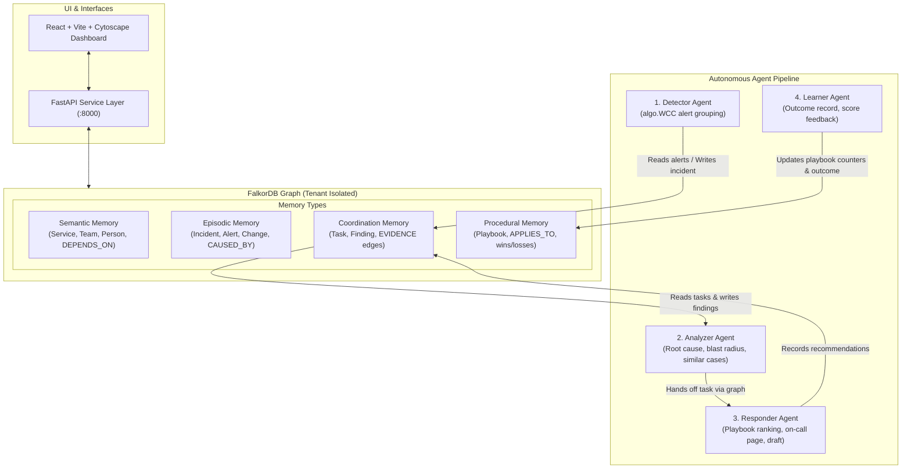

# Incident Commander: Graph-Powered AI Incident Response Team

Incident Commander is an autonomous incident response agent team whose shared brain is a FalkorDB knowledge graph. When cascading alerts fire, a multi-agent pipeline (Detector, Analyzer, Responder, Learner) traverses the service dependency topology to identify root causes, calculate blast radius, recall similar past incidents, rank proven playbooks, and page the most experienced on-call engineer—grounding every decision with verifiable graph evidence links rather than prompt hallucination, and closing the feedback loop by recording operator outcomes directly into procedural graph memory.

---

## Tracks Entered & How Each Is Satisfied

Built for **Graph Hacks: Context for AI Agents** (WeMakeDevs x FalkorDB). Entered in all three hackathon tracks:

| Track | Hackathon Track Focus | How Incident Commander Satisfies It |
| :--- | :--- | :--- |
| **Track 1** | **Agents That Act on Connected Data** | Agents execute Cypher queries on FalkorDB at every step: Detector groups open alerts using Weakly Connected Components (`algo.WCC`); Analyzer traverses `DEPENDS_ON` edges for blast radius and correlates recent `Change` events deployed upstream; Responder navigates `OWNS` and `ON_CALL_FOR` relationships to page the right human on-call engineer. |
| **Track 2** | **Agent Memory and Coordination** | Implements four distinct graph memory tiers in FalkorDB: Semantic (topology, teams), Episodic (past incidents and alert cascades), Procedural (learned playbook win/loss counters scored via $(s+1)/(s+f+2)$), and Coordination (immutable `Task` and `Finding` nodes with `EVIDENCE` edges). Agents never call each other via direct APIs; they coordinate strictly by reading and writing graph memory tasks with tenant-level run locks. |
| **Track 3** | **Company Brain** | Turns operational history into an institutional intelligence asset: identifies Knowledge Single Points of Failure (services where only one person has ever fixed an outage), highlights critical architectural bottlenecks using PageRank (`algo.pageRank`) and Betweenness Centrality (`algo.betweenness`), and maintains full service profiles with historical incident causes and expert rosters. |

---

## Architecture Diagram



---

## Data Model & Graph Memory

Each tenant runs in an isolated FalkorDB graph (`tenant_<id>`). The graph models four primary memory tiers:

### 1. Node Labels & Core Properties
- `Service`: `name` (id), `tier` (1, 2, 3), `language`, `slo_ms`.
- `Team`: `name` (id), `slack_channel`.
- `Person`: `name` (id), `role`, `oncall_now` (boolean).
- `Change`: `id`, `kind` (`config`, `deploy`, `infra`), `summary`, `at` (epoch timestamp).
- `Alert`: `id`, `metric`, `severity` (`critical`, `warning`), `fired_at`, `status` (`open`, `grouped`, `cleared`).
- `Incident`: `id`, `title`, `severity`, `status` (`open`, `resolved`), `started_at`, `resolved_at`, `recommended_playbook`.
- `Playbook`: `id`, `name`, `successes` (wins), `failures` (losses).
- `Task`: `task` (id), `agent`, `kind` (`detect`, `analyze`, `respond`, `learn`), `status` (`open`, `done`, `handed_off`, `failed`), `created_at`, `finished_at`.
- `Finding`: `id`, `agent`, `claim`, `confidence`, `query`, `created_at`.

### 2. Relationships (Edges)
- `(:Service)-[:DEPENDS_ON {kind, criticality}]->(:Service)`
- `(:Team)-[:OWNS]->(:Service)`
- `(:Person)-[:MEMBER_OF]->(:Team)`
- `(:Person)-[:ON_CALL_FOR]->(:Team)`
- `(:Person)-[:RESOLVED {minutes}]->(:Incident)`
- `(:Change)-[:MODIFIED]->(:Service)`
- `(:Alert)-[:FIRED_ON]->(:Service)`
- `(:Alert)-[:PART_OF]->(:Incident)`
- `(:Incident)-[:AFFECTED {role}]->(:Service)` (role: `'origin'` or `'impacted'`)
- `(:Incident)-[:CAUSED_BY]->(:Change)`
- `(:Incident)-[:FIXED_BY {worked, minutes}]->(:Playbook)`
- `(:Playbook)-[:APPLIES_TO]->(:Service)`
- `(:Finding)-[:EVIDENCE]->(:Node)` (links to concrete `Service`, `Change`, `Alert`, `Incident`, `Playbook`, or `Person` nodes)
- `(:Task)-[:HANDED_OFF_TO {reason, at}]->(:Agent)`

---

## Key Cypher Queries

### Questions an Agent Must Answer

Autonomous incident response requires reasoning over interconnected topology rather than isolated logs. The table below details why each operational question requires multi-hop graph traversal, along with measured live FalkorDB query latencies (measured via `python scripts/benchmark_queries.py --tenant acme` with 1 warm-up and 30 timed iterations on Windows 10 AMD64, 2026-10-18):

| Question | Why It Needs Multi-Hop Traversal | Cypher Query File | Measured Latency (Median / p95) |
| :--- | :--- | :--- | :--- |
| **What downstream services break if service X fails?** | Traverses reverse `DEPENDS_ON*1..4` dependency paths to identify all cascading victims ordered by tier and distance. | [`queries/blast_radius.cypher`](queries/blast_radius.cypher) | **1.46 ms** / 1.96 ms |
| **What recent changes were deployed upstream of alerting services?** | Correlates `Change` events deployed within the last 2 hours to services reachable within `DEPENDS_ON*0..3` hops. | [`queries/suspect_changes.cypher`](queries/suspect_changes.cypher) | **0.89 ms** / 1.31 ms |
| **What past incidents shared this root cause and cascade topology?** | Anchors on `(origin)` while calculating alert symptom overlap on `(i)-[:AFFECTED]->(s)` and change causality via `(i)-[:CAUSED_BY]->(c)`. | [`queries/similar_incidents.cypher`](queries/similar_incidents.cypher) | **2.06 ms** / 2.56 ms |
| **Which playbook has the highest empirical win rate for this service?** | Traverses `(:Playbook)-[:APPLIES_TO]->(s)` and computes Laplace-smoothed win/loss scores from historical resolution edges. | [`queries/best_playbook.cypher`](queries/best_playbook.cypher) | **1.18 ms** / 1.74 ms |
| **Who is on call for the owning team with the most prior outage fixes?** | Traverses `(s)<-[:OWNS]-(t)<-[:ON_CALL_FOR]-(p)` and counts historical `(p)-[:RESOLVED]->(:Incident)-[:AFFECTED]->(s)` links. | [`queries/who_to_page.cypher`](queries/who_to_page.cypher) | **1.23 ms** / 1.66 ms |
| **Which services have an organizational bus factor of exactly 1 engineer?** | Traverses all `(s)<-[:AFFECTED]-(:Incident)<-[:RESOLVED]-(p)` and filters services where `count(DISTINCT p) == 1`. | [`queries/knowledge_spof.cypher`](queries/knowledge_spof.cypher) | **1.64 ms** / 2.22 ms |

> [!NOTE]
> **Boundary Limit:** Latencies were measured on our synthetic graph topology of 40 microservices, 77 dependencies, and 30 historical incidents; this is not a production-scale enterprise dataset.

---

### Cypher Query Implementations

All agent reasoning executes directly against FalkorDB via parameterised Cypher queries in `queries/`:

### 1. Blast Radius (`queries/blast_radius.cypher`)
*Finds all downstream services that depend on the failing service up to 4 hops away, nearest first.*
```cypher
MATCH p = (impacted:Service)-[:DEPENDS_ON*1..4]->(origin:Service {name: $service})
RETURN impacted.name AS service, impacted.tier AS tier, min(length(p)) AS hops
ORDER BY hops, tier, service
```

### 2. Suspect Changes (`queries/suspect_changes.cypher`)
*Identifies recent deployments or configuration changes deployed to the alerting service or its upstream dependencies within the 2 hours prior.*
```cypher
MATCH (c:Change)-[:MODIFIED]->(s:Service)
WHERE c.at >= $incident_start - 7200
MATCH p = (affected:Service {name: $service})-[:DEPENDS_ON*0..3]->(s)
RETURN c.id AS change, c.kind AS kind, c.summary AS summary, c.at AS at,
       s.name AS changed_service, min(length(p)) AS distance
ORDER BY distance, at DESC
LIMIT 5
```

### 3. Similar Incidents (`queries/similar_incidents.cypher`)
*Retrieves past resolved incidents sharing the same suspected origin, scoring them by alerting service overlap and change causality.*
```cypher
MATCH (i:Incident {status: 'resolved'})-[:AFFECTED {role: 'origin'}]->(:Service {name: $suspect})
OPTIONAL MATCH (i)-[:AFFECTED]->(s:Service) WHERE s.name IN $alerting
WITH i, count(DISTINCT s) AS overlap
OPTIONAL MATCH (i)-[:CAUSED_BY]->(c:Change)
WITH i, overlap, count(c) AS change_caused
OPTIONAL MATCH (i)-[f:FIXED_BY]->(pb:Playbook) WHERE f.worked = true
RETURN i.id AS incident, i.title AS title, i.started_at AS started_at, overlap, change_caused,
       overlap + 2 * change_caused AS score, pb.id AS playbook_id, pb.name AS playbook, f.minutes AS minutes
ORDER BY score DESC, started_at DESC
LIMIT 5
```

### 4. Playbook Ranking (`queries/best_playbook.cypher`)
*Ranks playbooks applicable to the origin service using Laplace-smoothed historical success rates so 1-for-1 does not beat 9-for-10.*
```cypher
MATCH (pb:Playbook)-[:APPLIES_TO]->(:Service {name: $service})
RETURN pb.id AS playbook_id, pb.name AS name, pb.successes AS wins, pb.failures AS losses,
       toFloat(pb.successes + 1) / (pb.successes + pb.failures + 2) AS score
ORDER BY score DESC, name
```

### 5. Weakly Connected Components Alert Grouping (`queries/group_alerts_wcc.cypher`)
*Clusters open alerts that fired within 5 minutes of each other on services within 2 dependency hops into a unified incident.*
```cypher
CALL algo.WCC({nodeLabels: ['Alert'], relationshipTypes: ['RELATED_TO']}) YIELD node, componentId
WHERE node.status = 'open'
RETURN componentId, collect(node.id) AS alerts
ORDER BY size(alerts) DESC
```

### 6. Dependency Importance / PageRank (`queries/pagerank.cypher`)
*Computes topological centrality over service dependencies to establish blast radius priority.*
```cypher
CALL algo.pageRank('Service', 'DEPENDS_ON') YIELD node, score
RETURN node.name AS service, score
ORDER BY score DESC
LIMIT 10
```

### 7. Topological Chokepoints / Betweenness (`queries/betweenness.cypher`)
*Identifies critical architectural bridges sitting on high volumes of shortest dependency paths.*
```cypher
CALL algo.betweenness({nodeLabels: ['Service'], relationshipTypes: ['DEPENDS_ON']}) YIELD node, score
RETURN node.name AS service, score
ORDER BY score DESC
LIMIT 10
```

### 8. Who to Page (`queries/who_to_page.cypher`)
*Finds currently on-call engineers for the team owning the origin service, ranked by prior successful incident resolutions.*
```cypher
MATCH (s:Service {name: $service})<-[:OWNS]-(t:Team)<-[:ON_CALL_FOR]-(p:Person)
WHERE p.oncall_now = true
OPTIONAL MATCH (p)-[r:RESOLVED]->(:Incident)-[:AFFECTED]->(s)
RETURN p.name AS person, p.role AS role, t.name AS team, t.slack_channel AS channel, count(r) AS prior_fixes
ORDER BY prior_fixes DESC
```

### 9. Knowledge Single Point of Failure (`queries/knowledge_spof.cypher`)
*Surfaces services where exactly one engineer has ever resolved an outage, flagging critical organizational knowledge silos.*
```cypher
MATCH (s:Service)
OPTIONAL MATCH (p:Person)-[:RESOLVED]->(:Incident)-[:AFFECTED]->(s)
WITH s, count(DISTINCT p) AS people_who_fixed_it
WHERE people_who_fixed_it = 1
RETURN s.name AS service, s.tier AS tier, people_who_fixed_it
ORDER BY tier, service
```

---

## How Agents Coordinate

In Incident Commander, **agents never call each other via direct APIs, RPCs, or in-memory message queues**. Instead, coordination is entirely decoupled through FalkorDB:
1. **Detector** groups alerts via Cypher WCC, creates the `Incident` node, and creates an `analyze` `Task` node assigned to `Analyzer`.
2. **Analyzer** queries pending `Task` nodes, investigates upstream changes and blast radius, records `Finding` nodes with `EVIDENCE` edges to concrete graph entities, and updates the task status to `handed_off` targeting `Responder` with reason: `"origin identified: currency"`.
3. **Responder** queries its assigned tasks, executes `similar_incidents` and `best_playbook`, calculates the composite score, records a recommendation `Finding`, drafts a status report, and marks its task `done`.
4. **Learner** executes on human feedback (`POST /incidents/{id}/resolve`): runs an atomic Cypher query updating the incident status and playbook win/loss counters, and writes a `learn` `Task` and `Finding` with evidence links.

Every step leaves an immutable audit trail in FalkorDB.

---

## Why the Decoys Lose

In incident response, naive symptom matching or vector similarity based solely on superficial text alerts (`"checkout slow"`, `"frontend errors"`) frequently misleads agents into choosing the wrong playbooks. In our synthetic dataset, two planted decoys test the pipeline:
- **`INC-021` (Decoy on different service):** Superficial symptom overlap on `checkout` and `frontend`, but its true root cause was `payment`.
- **`INC-007` (Decoy on same service):** Also caused by `currency`, but had lower overlap, was NOT caused by a configuration change, and was resolved by `PB-05` (`flush-cache`).

Running `python scripts/prove_decoys.py --tenant acme` proves on live FalkorDB why `INC-014` ranks #1:

```text
Scenario Parameters:
  Suspected Origin: currency
  Alerting Services (4): ['cart', 'checkout', 'frontend', 'payment']

Live Cypher Query Result (`queries/similar_incidents.cypher`):
Rank  Incident     Score   Overlap   Chg Caused   Playbook                  Title
----------------------------------------------------------------------------------------------------
1     INC-014      4       2         1            rollback-pool-config (11m) currency latency spike, checkout slow
2     INC-007      1       1         0            flush-cache (14m)         currency elevated error rate, cart failing

Detailed Score Breakdown of Planted Incidents:
====================================================================================================
[INC-007] currency elevated error rate, cart failing
  * Origin Service:        currency (Matches Suspect 'currency': True)
  * Downstream Impacted:   ['cart']
  * Alerting Overlap:      ['cart'] -> count = 1
  * Causal Change:         None -> factor = +0
  * Total Incident Score:  1 + 2*(0) = 1
  * Historical Fix:        PB-05 (flush-cache) in 14 min (worked=True)
----------------------------------------------------------------------------------------------------
[INC-014] currency latency spike, checkout slow
  * Origin Service:        currency (Matches Suspect 'currency': True)
  * Downstream Impacted:   ['frontend', 'checkout', 'quote']
  * Alerting Overlap:      ['checkout', 'frontend'] -> count = 2
  * Causal Change:         CHG-0007 (config: Lower DB connection pool 50 -> 10) -> factor = +2
  * Total Incident Score:  2 + 2*(1) = 4
  * Historical Fix:        PB-04 (rollback-pool-config) in 11 min (worked=True)
----------------------------------------------------------------------------------------------------
[INC-021] payment provider timeouts, checkout slow
  * Origin Service:        payment (Matches Suspect 'currency': False)
  * Downstream Impacted:   ['checkout', 'frontend']
  * Alerting Overlap:      ['checkout', 'frontend'] -> count = 2
  * Causal Change:         None -> factor = +0
  * Total Incident Score:  2 + 2*(0) = 2
  * Historical Fix:        PB-10 (enable-circuit-breaker) in 19 min (worked=True)
====================================================================================================
EXPLICIT VERDICT: WHY INC-014 RANKS FIRST & DECOYS LOSE:
1. INC-014 vs INC-007: Both originate on currency, but INC-014 has higher alert overlap (2 vs 1) and was triggered by a config change (+2 causality score), yielding Score 4 vs 1.
2. INC-014 vs INC-021: Topologically eliminated because INC-021 originated on payment, not currency. Its playbook (PB-10 circuit breaker) cannot fix database pool exhaustion on currency.
```

---

## The Agent Learns from Failure Too

Closed-loop learning must penalize failing interventions just as effectively as it rewards successful fixes. In Incident Commander, if an operator attempts a playbook that fails (`worked=False`), the Learner agent increments the failure counter in procedural graph memory. Because playbooks are scored using Laplace smoothing:

$$\text{Score} = \frac{\text{Wins} + 1}{\text{Wins} + \text{Losses} + 2}$$

A recorded failure immediately lowers the empirical score and can re-order the recommendation queue. Running `python scripts/prove_learning.py --tenant acme` proves this on live FalkorDB:

```text
================================================================================
PART A: LEARNING FROM SUCCESS (Playbook PB-04 Worked)
================================================================================
PB-04 Before Resolve: Wins=6, Losses=0 -> Score = 0.875
Recorded Resolution: Playbook PB-04 WORKED in 12 min (Operator: Priya Raman)
Score Shift: 0.875 -> 0.889 (delta = +0.014)

================================================================================
PART B: LEARNING FROM FAILURE (Playbook PB-05 Failed)
================================================================================
Pre-Failure Rankings for 'currency':
- PB-05 (flush-cache):          Wins=6, Losses=1 -> Score = 0.778 (Ranked #2)
- PB-01 (rollback-last-change): Wins=12, Losses=4 -> Score = 0.722 (Ranked #3)

Recording Failure: Operator tried PB-05 on currency, but it FAILED (worked=False, 25 min)
Score Shift: 0.778 -> 0.700 (delta = -0.078)

Post-Failure Rankings for 'currency':
- PB-01 (rollback-last-change): Score = 0.722 (Promoted to Rank #2)
- PB-05 (flush-cache):          Score = 0.700 (Demoted to Rank #4)

[SUCCESS] PB-05's failure dropped its score below PB-01 (0.700 < 0.722), demoting PB-05 in the queue!
```

---

## Local Setup (Tested PowerShell Commands)

Follow these exact steps in Windows PowerShell from the project root:

```powershell
# 1. Start FalkorDB container with append-only persistence
docker compose up -d

# 2. Activate Python virtual environment and install dependencies
# (Assumes venv at python-envs\incident-commander or create a new .venv)
python -m venv .venv
.\.venv\Scripts\Activate.ps1
pip install -r requirements.txt

# 3. Create .env configuration
Copy-Item .env.example .env

# 4. Seed isolated tenant graphs (synthetic deterministic datasets)
python scripts\seed.py --tenant acme --reset
python scripts\seed.py --tenant globex --seed 2 --no-plant --reset

# 5. Verify all Cypher queries against live FalkorDB
python scripts\check_queries.py --tenant acme

# 6. Run offline test suite (55 tests)
python -m unittest discover -s tests -v

# 7. Start FastAPI Backend Server (Port 8000)
python -m uvicorn src.ic.api:app --host 127.0.0.1 --port 8000

# 8. Start Frontend React Dashboard (Port 5173 in a new terminal)
cd frontend
npm install
npm run dev -- --host 127.0.0.1 --port 5173
```

- **Dashboard:** http://localhost:5173
- **FastAPI Swagger Docs:** http://localhost:8000/docs
- **FalkorDB Browser:** http://localhost:3001

---

## Demo Walkthrough

1. **Open Dashboard:** Navigate to `http://localhost:5173`. Notice tenant switch (`tenant_acme`), API health badge, and synthetic data banner.
2. **Inject Scenario:** Click **"Inject Demo Incident"** to simulate a faulty configuration change on `currency` and four cascading alerts on `checkout`, `cart`, `frontend`, and `payment`.
3. **Run Pipeline:** Click **"Run Agent Pipeline"**. Watch Detector group the alerts into `INC-...`, Analyzer trace the cause to `currency` and calculate the 11-service blast radius, and Responder recommend `rollback-pool-config` (`PB-04`) and page Priya Raman.
4. **Explore Interactive Graph:** View the Cytoscape topology. Click **"Highlight Explain Path"** to trace the shortest path from alerting nodes to `currency`.
5. **Inspect Evidence ("Why?" Panel):** Switch to the **"Why?" Evidence Panel**. Click on any evidence pill (`currency`, `CHG-LIVE-...`) to focus and center that node on the graph.
6. **Inspect Agent Coordination:** Switch to **"Agent Coordination Tasks"** to see the immutable hand-off chain between Analyzer and Responder.
7. **Simulate Operator Resolution (The Learning Money Shot):** Go to **"Memory & Response"**, confirm `PB-04` worked, and click **"Record Simulated Resolution"**. Watch the score move live (e.g., `0.800 -> 0.833`), and observe how the newly resolved incident becomes the top similar incident for subsequent incidents.
8. **Company Brain:** Switch to the **"Company Brain (Track 3)"** tab. View knowledge single points of failure, PageRank centrality, and chokepoints. Click **"Inspect"** to open the slide-out **Service Profile Drawer** showing owning teams, on-call engineers, and dependency trees.

---

## Verification & Proof Results

Verified against live FalkorDB and captured in `docs/VERIFICATION.md`:
- **Offline Tests:** 55 passing unit tests (`Ran 55 tests in 0.048s: OK`).
- **Live Query Audit:** 100% of Cypher queries in `queries/` pass against live FalkorDB (`scripts/check_queries.py`).
- **Tenant Isolation:** `scripts/prove_isolation.py` proves injecting and resolving in `acme` creates zero changes in `globex`, and unknown tenants return 404 without creating orphan graphs.
- **Concurrency Guards:** Simultaneous `/incidents/run` triggers return 409 Conflict for duplicate requests.
- **Persistence:** Injected and resolved incidents survive `docker restart incident-commander-falkordb` under AOF persistence.
- **Automated UI Suite:** Headless Playwright script (`scripts/drive_ui.py`) verified the complete UI flow and saved 7 screenshots to `docs/screenshots/`.

---

## Limitations

- **Synthetic Data:** All service names, alerts, team rosters, and historical incidents are synthetically generated by deterministic seeds.
- **Simulated Outcomes:** Operator resolutions update procedural graph memory for AI learning; no real production infrastructure rollback is triggered.
- **Optional Language Model:** Responder generates deterministic status drafts directly from graph facts. An LLM (e.g. Anthropic Claude) is purely optional for text polish and is bypassed if no API key is set.

---

## AI Usage Disclosure

This project was built with AI coding assistance adhering strictly to Graph Hacks Rule 11. Full disclosures regarding prompts, models, and author verification are documented in [AI_USAGE.md](file:///T:/Agent%20WMD%202/incident-commander/AI_USAGE.md).

---

## Demo Video

- **Video Link:** [DEMO VIDEO LINK PLACEHOLDER - To be recorded by author using docs/DEMO_SCRIPT.md]

---

## License

MIT License. Copyright (c) 2026 Thiru Mughil Senthur R.
